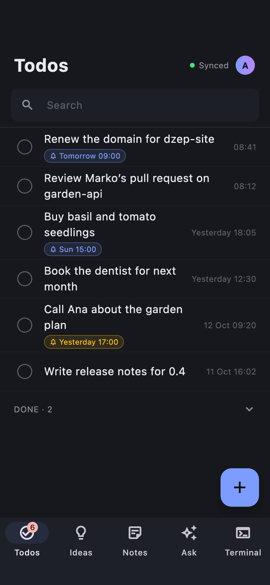
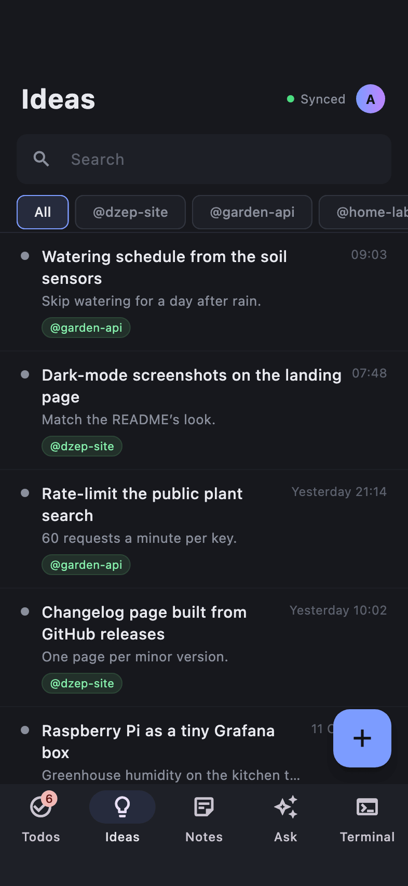
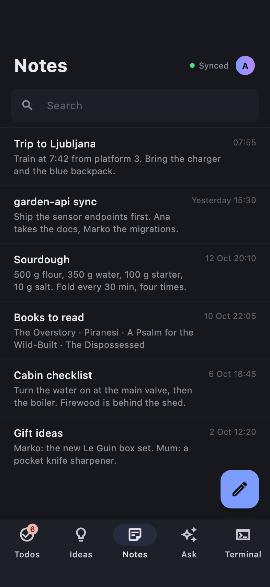
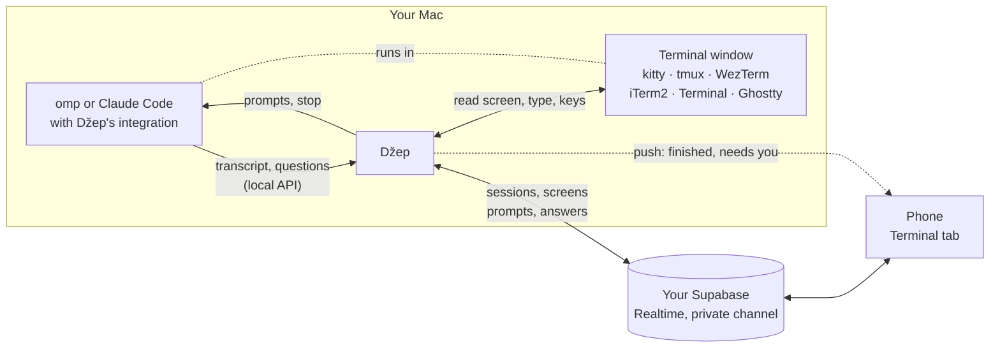
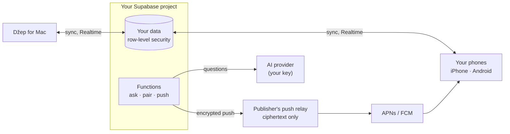

# Džep

**A pocket for ideas, todos, notes and quick AI questions.** A Mac menu-bar app with an ⇧⌘Space popup, plus iPhone and Android apps, synced through **your own** free Supabase server: there is no Džep cloud. From the phone you can also follow and prompt the [omp](https://github.com/can1357/oh-my-pi) and [Claude Code](https://github.com/anthropics/claude-code) sessions and other terminal windows on your Mac.

*Džep* (Croatian, "pocket") is pronounced roughly "jep".

- **Capture anywhere:** the Mac popup, phone widgets, `/idea`, `/do` and `/note` in your coding agent.
- **Todos with reminders:** `call bank !15:00` reminds every device; tick it off on one, it's done on all.
- **Notes and Ask:** free-text notes, and short streamed chats with any OpenAI-compatible AI.
- **Terminal from the phone:** your Mac's coding sessions as a conversation, with a push when the agent finishes or needs you.
- **Private:** everything lives in a Supabase project you own; pushes reach your phones encrypted.

<table>
  <tr>
    <td></td>
    <td></td>
  </tr>
  <tr>
    <td></td>
    <td></td>
  </tr>
</table>

<table>
  <tr>
    <td></td>
    <td></td>
    <td></td>
    <td></td>
  </tr>
</table>

## Install

| Device | Where |
| --- | --- |
| **Mac** (macOS 13+) | Download `Dzep-x.y.z.dmg` from [GitHub Releases](https://github.com/danyzmaj-apps/dzep/releases/latest) and drag Džep to Applications. Notarized; updates itself. |
| **iPhone** (iOS 17+) | TestFlight: *link coming soon* |
| **Android** (8.0+) | Google Play (open testing): *link coming soon* |

> **Coming soon:** the TestFlight and Google Play links. Until then, [build the phone app from source](docs/BUILDING.md).

You'll also need a free [Supabase](https://supabase.com) account (it hosts your server) and a [GitHub](https://github.com) account (the Mac signs in to your server with GitHub). Optional: an API key for any OpenAI-compatible AI for Ask; for Terminal from the phone, omp or Claude Code (2.1.287+) and one of the [terminals below](#terminal-from-the-phone).

## Set up

Open Džep on the Mac. With no server yet, it starts a wizard (**Set up my server**) that takes about five minutes:

1. **Supabase access token:** create one (`sbp_…`) and paste it. It's used for this setup only and never saved.
2. **Project:** create a new one (best) or use one you have.
3. **GitHub sign-in:** register a GitHub OAuth app with the values the wizard shows, and paste its Client ID and secret.
4. **AI (optional):** pick a provider and paste its key, or **Skip AI for now** and connect one later in **Settings → AI**.
5. Džep creates the tables, security rules and functions (**Retry** resumes a failed step), then you **sign in with GitHub**. The first account owns the server.

Prefer a terminal, or want the details? [docs/SELF_HOSTING.md](docs/SELF_HOSTING.md). Already have a Džep server? **I already have one: connect it**.

## Add your phone

1. On the Mac, open **Settings → Set up phone…**. It shows a QR code.
2. In the phone app, tap **Scan the code from your Mac** (or **Paste a code instead**).

The phone connects and signs in as you. A code works **once**, for **10 minutes**, and anyone who scans it gets into your account, so show it only to your own phone. Phones never use a password or GitHub. For App Store or Play review, **Settings → Reviewer access** makes a code for a separate demo account ([details](docs/SELF_HOSTING.md#app-store-and-play-review)).

## Use it

- **Mac:** ⇧⌘Space opens the popup; ⌘1–⌘4 switch between **Idea**, **Todo**, **Note** and **Ask**, ⌘5 opens the main window. A note can float in its own window (⌘P). There's a **Todos** widget too.
- **Reminders:** end a todo with `!15:00`, `!tomorrow`, `!fri 9`, `!30m` …; every device reminds you, phones by push.
- **Phones:** tabs for Todos, Ideas, Notes, Ask and Terminal; **Todos** and **New idea** widgets.
- **Coding agents:** `/idea`, `/do` and `/note` in omp and Claude Code, filed under the current repo.

**Does the Mac have to be on?** Not for your data: ideas, todos, notes, reminders and Ask live on your server, so the phones work on their own with the Mac off. The Mac is needed only to add a new phone (its code) and for Terminal from the phone (below).
All the keys, the reminder syntax and more: [docs/USING.md](docs/USING.md).

## Terminal from the phone

The phone's Terminal tab shows the Mac's omp and Claude Code sessions as conversations (prompt with images, stop, answer questions, approvals and plan reviews) and any other terminal window as a live screen you can type into. **+** opens a new session in one of your projects. When a run ends or the agent needs you, a push takes you there; a session you follow is a Live Activity (iPhone) or an ongoing notification (Android).

> **Your Mac has to be awake, with Džep running and Settings → Terminal from phone on.** The sessions and windows are on the Mac; the phone only shows and drives them. While Terminal from phone is on, Džep keeps the Mac from going to sleep when idle, but a closed lid (without an external display) or a shut-down Mac still ends it: the phone then says the Mac isn't answering. Pushes for a run that ends while you're away need the Mac awake too.

What works depends on the terminal:

| Terminal | Sessions & screens | Colors | Keys & answers from phone | Close |
| --- | --- | --- | --- | --- |
| kitty | ✓ | ✓ | ✓ | ✓ |
| iTerm2 | ✓ | – | ✓ | ✓ |
| WezTerm | ✓ | ✓ | ✓ | ✓ |
| tmux (in any terminal) | ✓ | ✓ | ✓ | ✓ |
| Ghostty | Sessions, no screen | – | ✓ | ✓ |
| Terminal (macOS's) | ✓, whole lines only | – | – (answer on the Mac) | ✓ |

With tmux installed (`brew install tmux`), sessions the phone starts in Terminal or Ghostty run inside tmux and get full control.

<table>
  <tr>
    <td></td>
    <td></td>
    <td></td>
  </tr>
</table>

To turn it on: on the Mac, **Settings → Terminal from phone** (off by default); **Settings → Terminals** shows each terminal as Ready, Limited or Needs setup and fixes what it can (kitty: **Set up…**; iTerm2, Terminal, Ghostty: allow Automation); **Settings → Coding agent** installs Džep's integration for omp or Claude Code. Step by step: [docs/USING.md](docs/USING.md#terminal-from-the-phone).

## Privacy

- **Your data, your server.** Everything you write lives in your Supabase project, behind row-level security; the apps hold only its publishable key. Anyone else's sign-up is refused unless you allow their email ([Sharing](docs/SELF_HOSTING.md#sharing)).
- **AI key:** a secret on your server; it never reaches the apps.
- **Push:** only the publisher can reach Apple's and Google's push services for Džep, so your server sends through the publisher's relay, encrypted with a key only your phone has. The relay sees a push token, the kind of notification and ciphertext, never titles, todo text or terminal output, and stores nothing. iPhone Live Activity updates can't be encrypted: they carry only a session's state (working, needs you, finished).
- **Terminal from the phone** lets anyone signed in to your account type into your terminals. It's off by default, runs over a Realtime channel only your account can join, and nothing it carries is stored.
- **Delete everything** from Mac Settings → **Delete account**, or the phone's account menu.

Full policy: [docs/PRIVACY.md](docs/PRIVACY.md). Report vulnerabilities privately: [SECURITY.md](SECURITY.md).

## More

- [docs/USING.md](docs/USING.md): every feature, key and setting.
- [docs/SELF_HOSTING.md](docs/SELF_HOSTING.md): the server by script, AI providers, sharing, updating, [troubleshooting](docs/SELF_HOSTING.md#troubleshooting).
- [docs/BUILDING.md](docs/BUILDING.md): build the apps with your own signing identity.
- [docs/ARCHITECTURE.md](docs/ARCHITECTURE.md): how the pieces fit, and why some look odd.
- [docs/RELEASING.md](docs/RELEASING.md): how releases are made.
- [CONTRIBUTING.md](CONTRIBUTING.md): issues and pull requests are welcome. Still stuck? [Open an issue](https://github.com/danyzmaj-apps/dzep/issues/new/choose).

The repo is a Dart pub workspace: the Mac app and the backend it deploys in [`apps/dzep-macos-app/`](apps/dzep-macos-app/), the iPhone and Android app in [`apps/dzep-mobile/`](apps/dzep-mobile/), shared code in [`packages/dzep_core/`](packages/dzep_core/).

**Forking?** The Apple team, bundle ids, Android package, Sparkle feed and push relay default to the publisher's. Builds for yourself override the team and ids in `config/Local.xcconfig` ([BUILDING.md](docs/BUILDING.md#your-signing-identity)); a fork that ships its own apps also sets its own Android package ([BUILDING.md](docs/BUILDING.md#android)), Sparkle key and feed ([RELEASING.md](docs/RELEASING.md#one-time-setup-maintainers-mac)) and push relay ([SELF_HOSTING.md](docs/SELF_HOSTING.md#your-own-app-id-and-relay)).

## License

[MIT](LICENSE) © Danijel Lovric
