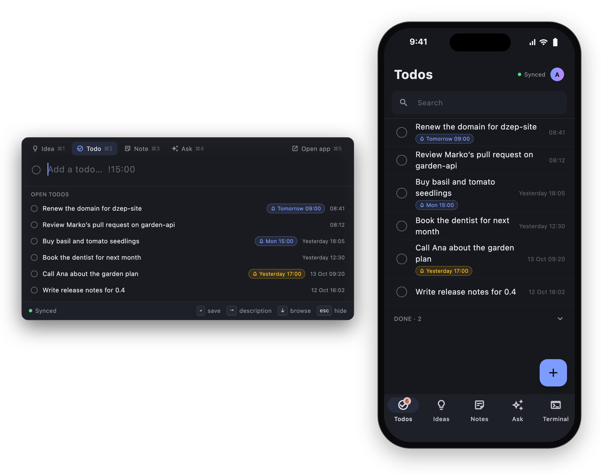
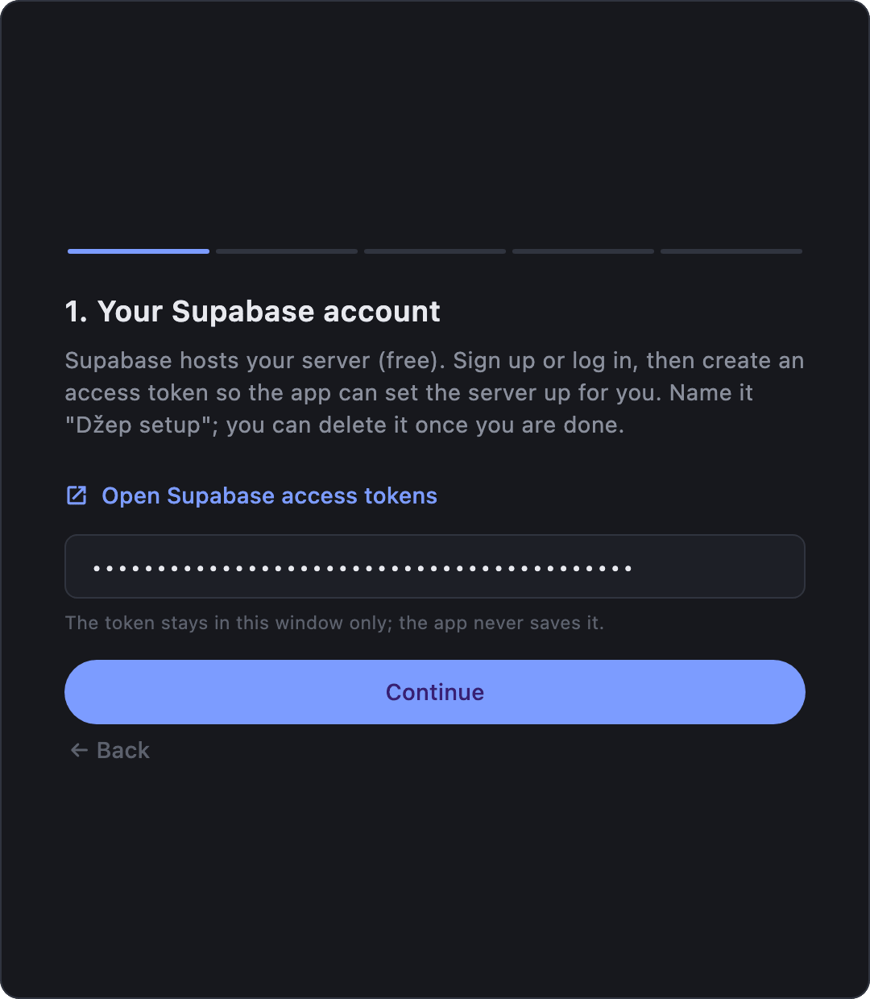
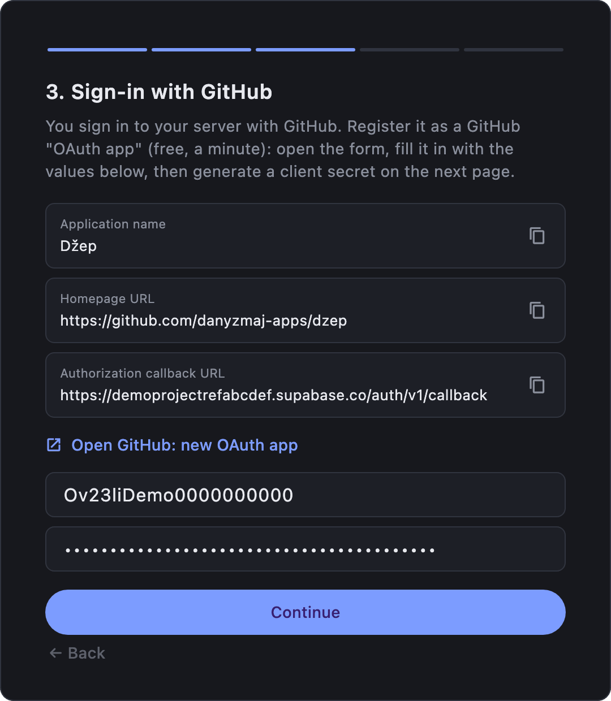
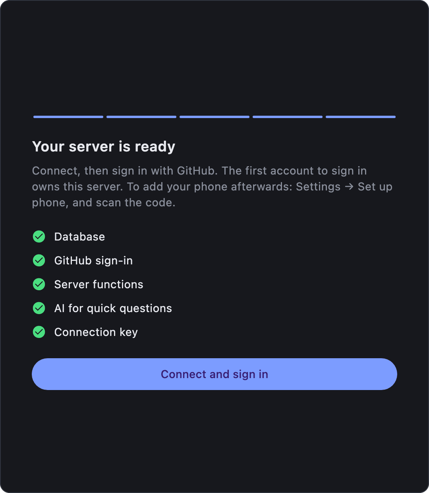
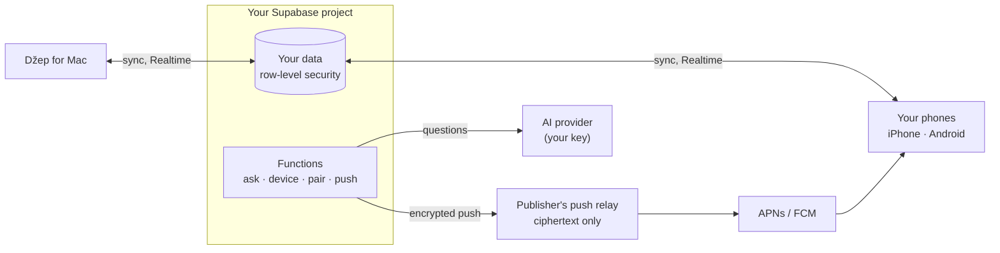

# Džep

**A pocket for ideas, todos, notes and quick AI questions: on your Mac, your phone and your own server.**

  

Džep is a Mac menu-bar app with an ⇧⌘Space popup, plus iPhone and Android apps. They sync through a free [Supabase](https://supabase.com) project that **you** own: there is no Džep cloud. *Džep* is Croatian for "pocket", said roughly "jep".

## What it does

- **Capture anywhere:** the Mac popup, phone widgets, or `/idea`, `/do` and `/note` in your coding agent.
- **Todos with reminders:** `call bank !15:00` reminds every device; tick it off on one and it's done on all.
- **Notes and Ask:** free-text notes, and short streamed chats with any OpenAI-compatible AI.
- **Terminal from the phone:** your Mac's [omp](https://github.com/can1357/oh-my-pi) and [Claude Code](https://github.com/anthropics/claude-code) sessions as a conversation, with a push when the agent finishes or needs you.
- **Private by design:** your data stays in your Supabase project, and pushes reach your phones encrypted.

## Install

| Device | Get it |
| --- | --- |
| **Mac** (macOS 13+) | `Dzep-x.y.z.dmg` from [GitHub Releases](https://github.com/danyzmaj-apps/dzep/releases/latest). Notarized; updates itself. |
| **iPhone** (iOS 17+) | TestFlight: *coming soon* |
| **Android** (8.0+) | Google Play: *coming soon* |

Until the phone links are up, you can [build the phone app from source](docs/BUILDING.md).

## Get started

1. **Set up your server.** Open Džep on the Mac and click **Set up my server**. The wizard takes about five minutes and needs a free [Supabase](https://supabase.com) account (it hosts your server) and a [GitHub](https://github.com) account (you sign in with it). An AI key for Ask is optional. Would you rather use a script? See [SELF_HOSTING.md](docs/SELF_HOSTING.md).
2. **Add your phone.** On the Mac, open **Settings → Set up phone…**, then tap **Scan the code from your Mac** in the phone app. The code works once, for 10 minutes.
3. **Capture.** Press ⇧⌘Space anywhere on the Mac. ⌘1–⌘4 switch between **Idea**, **Todo**, **Note** and **Ask**. Every key and setting is in [USING.md](docs/USING.md).

<table>
  <tr>
    <td width="33%"></td>
    <td width="33%"></td>
    <td width="33%"></td>
  </tr>
  <tr>
    <td align="center">Paste a Supabase token (used once, never saved)</td>
    <td align="center">Register a GitHub sign-in app: copy each value</td>
    <td align="center">Done: connect and sign in with GitHub</td>
  </tr>
</table>

## Terminal from the phone

The phone's Terminal tab shows the Mac's omp and Claude Code sessions as conversations. From it you can prompt (with images), stop a run, and answer questions, approvals and plan reviews. Any other terminal window shows as a live screen you can type into, and **+** opens a new session in one of your projects.

  

What works depends on the terminal:

| Terminal | Sessions & screens | Colors | Keys & answers from phone | Close |
| --- | --- | --- | --- | --- |
| kitty | ✓ | ✓ | ✓ | ✓ |
| iTerm2 | ✓ | – | ✓ | ✓ |
| WezTerm | ✓ | ✓ | ✓ | ✓ |
| tmux (in any terminal) | ✓ | ✓ | ✓ | ✓ |
| Ghostty | Sessions, no screen | – | Keys; – (answer on the Mac) | ✓ |
| Terminal (macOS's) | ✓, whole lines only | – | – (answer on the Mac) | ✓ |

With tmux installed (`brew install tmux`), sessions the phone starts in Terminal or Ghostty run inside tmux and get full control. To turn it on, use Mac **Settings → Terminal from phone** (off by default). **Settings → Terminals** and **Settings → Coding agent** set up the rest ([step by step](docs/USING.md#terminal-from-the-phone)). Claude Code needs version 2.1.287 or later.

> [!NOTE]
> **Your Mac has to be awake, with Džep running and Terminal from phone on.** The sessions live on the Mac; the phone only shows and drives them. While Terminal from phone is on, Džep keeps an idle Mac from sleeping, but a closed lid (without an external display) or a shut-down Mac still ends it: the phone then says the Mac isn't answering. Pushes for a run that ends while you're away need the Mac awake too. Your ideas, todos, notes, reminders and Ask don't need the Mac; only adding a phone does.

## Privacy & security

- **Your data, your server.** Everything you write lives in your Supabase project, behind row-level security. The apps hold only its publishable key, and nobody else can sign up unless you allow their email. Your AI key is a secret on your server and never reaches the apps.
- **Encrypted push.** Your server sends pushes through the publisher's relay, encrypted with a key only your phone has. The relay sees ciphertext and stores nothing. iPhone Live Activity updates can't be encrypted, so they carry only a session's state and, when it needs you, whether for a question, an approval or a plan.
- **Terminal from the phone** is off by default. It runs over a Realtime channel only your account can join, and nothing it carries is stored. **Settings → Delete account** removes everything.

The full policy is in [PRIVACY.md](docs/PRIVACY.md). Report vulnerabilities privately as described in [SECURITY.md](SECURITY.md).

## Documentation

| | |
| --- | --- |
| [USING.md](docs/USING.md) | Every feature, key and setting, with screenshots |
| [SELF_HOSTING.md](docs/SELF_HOSTING.md) | The server by script, AI providers, sharing, updating, troubleshooting |
| [ARCHITECTURE.md](docs/ARCHITECTURE.md) | How the pieces fit, and why some of them look odd |
| [BUILDING.md](docs/BUILDING.md) | Building the apps with your own signing identity, and the screenshots |
| [RELEASING.md](docs/RELEASING.md) | How releases are made |
| [CONTRIBUTING.md](CONTRIBUTING.md) | Setting up the repo, and what a pull request needs |
| [SECURITY.md](SECURITY.md) | Reporting a vulnerability, and the security model |
| [PRIVACY.md](docs/PRIVACY.md) | What the apps send, and to whom |

## Contributing

Issues and pull requests are welcome; start with [CONTRIBUTING.md](CONTRIBUTING.md).

## License

[MIT](LICENSE) © Danijel Lovric
