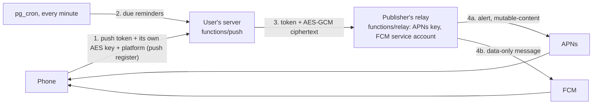

# Architecture

How Džep is put together, and why some of it looks the way it does. For what it does and how to set it up, see the [README](../README.md).

One Dart pub workspace (root `pubspec.yaml`): the Mac app in `apps/dzep-macos-app/` (with the backend it bundles), the phone app for iPhone and Android in `apps/dzep-mobile/`, and what both use in `packages/dzep_core/` (each with its own `lib/` and `test/`). Below, `core/` stands for `packages/dzep_core/`, `mac/` for `apps/dzep-macos-app/` and `mobile/` for `apps/dzep-mobile/`. "Phone" means iPhone and Android alike; where they differ, the text says so.

## Layout

| Path | What |
| --- | --- |
| `core/lib/idea.dart` | One row of `ideas`: an idea or a todo (`kind`); `parseTitle` for `@project` tokens |
| `core/lib/session.dart` | The connected backend, GitHub sign-in and the user's `IdeaStore` / `ChatStore` (shared) |
| `core/lib/account.dart` | Sign-in page, GitHub button, avatar (Mac and phone) |
| `core/lib/backend.dart`, `connect.dart` | Which Supabase project to use: parsing and checking it, setup links, the connect-an-existing-server form |
| `mac/lib/setup_page.dart`, `mac/lib/onboarding/` | Mac first-run setup: the wizard (`flow.dart`, `wizard.dart`), provisioning through the Supabase Management API (`supabase_admin.dart`, `provision.dart`), the pairing QR (`pair.dart`) |
| `mobile/lib/setup_page.dart`, `mobile/lib/onboarding/scan.dart` | Phone first run: scan the Mac's code, or paste a setup link (phones pair only; they never set up a server) |
| `core/lib/logo.dart` | The pocket mark, drawn in Flutter (the app icons come from `mac/tool/make_icon.swift`) |
| `core/lib/remind.dart` | Reminders: the `!` parser, how a time reads, which todos should have a notification pending (pure Dart, `core/test/remind_test.dart`) |
| `core/lib/store.dart` | Local JSON cache + Supabase sync (push dirty, pull since cursor, realtime) |
| `core/lib/native.dart` | The `dzep/native` platform channel to the native side of each app (Swift on Mac and iPhone, Kotlin on Android; same methods and events everywhere) |
| `mac/lib/main.dart`, `controller.dart`, `popup.dart`, `main_window.dart`, `note_window.dart` | Mac app |
| `core/lib/chat.dart`, `chat_view.dart` | Quick questions: `ChatStore` (synced chats, streaming from `ask`) and the transcript/list/thread widgets (Mac and phone) |
| `core/lib/kitty.dart` | Mac: kitty's remote control, spoken directly over its unix socket (windows, screen lines, typing, keys, new windows) |
| `core/lib/live.dart` | Terminal from the phone: the protocol and what both sides share (transcript items and their seq/epoch log, questions and the keys that answer them, screen diffs); pure Dart, `core/test/live_test.dart` |
| `mac/lib/live_hub.dart` | Mac: the omp sessions reporting over the local API's `/v1/live` WebSocket |
| `mac/lib/terminal_bridge.dart` | Mac: the phone's way in, sessions and kitty screens out on the Realtime topic, its requests in |
| `core/lib/terminal_channel.dart` | Mac and phone: the private topic, kept joined (a fresh channel and token after any close, refusal or stuck join) |
| `core/lib/terminal_remote.dart`, `mobile/lib/session_view.dart`, `terminal_view.dart` | Phone: the remote and its disk cache, an omp session's transcript and composer, the Terminal tab, kitty screens and new sessions |
| `core/lib/live_activity.dart` | Phone: followed omp sessions (Live Activities on iOS, ongoing notifications on Android; start, local updates, push tokens to the server); Mac and phone: a session's state as an activity's (`core/test/live_activity_test.dart`) |
| `mac/lib/local_api.dart` | Mac: 127.0.0.1 API for `/idea`, `/todo`, `/note`, pushes and omp's live sessions |
| `mobile/lib/main.dart`, `mobile.dart` | Phone app (iPhone and Android) |
| `mac/macos/Runner/MainFlutterWindow.swift`, `AppDelegate.swift` | Popup panel, main window and note window on one multi-view engine, menu-bar icon, Carbon hotkey, activation policy, launch at login, reminder notifications, idle time |
| `mobile/ios/Runner/AppDelegate.swift` | The iPhone half of `native.dart`: App Group, reminder notifications, push registration, Live Activities |
| `mobile/android/app/src/main/kotlin/…/MainActivity.kt` | The Android half of `native.dart`: the same methods and events as the iPhone's |
| `mobile/android/…/DzepShared.kt` | Android's counterpart of `DzepShared.swift`: shared preferences (backend, device token, todos, offline queue, push key) and the `device` function client |
| `mobile/android/…/PushService.kt` | Android: FCM service, opens sealed data messages, shows reminders and terminal notifications, updates ongoing omp notifications |
| `mobile/android/…/Reminders.kt`, `OmpActivities.kt` | Android: local reminders (AlarmManager, re-armed after boot) with **Done**; the ongoing notification per followed omp session |
| `mobile/android/…/TodosWidget.kt`, `NewIdeaWidget.kt` | Android home-screen widgets |
| `mobile/ios/DzepPush/` | Notification Service Extension: decrypts pushes |
| `mobile/ios/Runner/AddIdeaIntent.swift` | Siri / Action Button intents (Add Idea, Add Todo) |
| `mobile/ios/DzepWidget/` | WidgetKit extension (Todos, New idea, the omp session Live Activity) |
| `mac/macos/DzepWidget/` | Mac WidgetKit extension (Todos), sandboxed; its ticks go through the running app |
| `mobile/ios/Shared/DzepShared.swift` | App Group storage + `device` function client (app and widget; the Mac's app and widget compile it too, from this path) |
| `mobile/ios/Shared/OmpActivity.swift` | The omp session Live Activity's attributes and state (iPhone app and widget only) |
| `mac/supabase/` | Migrations and the `ask`, `device`, `pair` and `push` edge functions (bundled as Mac app assets for the setup wizard); `relay` is the publisher's push relay for APNs and FCM (`mac/tool/deploy-relay.sh`) |
| `mobile/maestro/` | Simulator flows |
| `config/Dzep.xcconfig` | Team, bundle id and App Group for every Xcode target of both apps (`Local.xcconfig` overrides them) |
| `mac/tool/setup-backend.sh`, `release.sh` | Self-hosting setup; Mac release (DMG, notarization, Sparkle appcast) |
| `mac/integrations/omp/idea.ts`, `live.ts` | omp extensions: `/idea`, `/todo` and `/note`; the session, live, for the phone |
| `core/lib/chat_images.dart` | Images in quick questions: preparing (downscale, PNG), paste and pick, the composer strip and transcript thumbnails |

## Backend

Every user runs their own Supabase project ([SELF_HOSTING.md](SELF_HOSTING.md)), built from `mac/supabase/migrations` and `mac/supabase/config.toml`; nothing is shared between users. The Mac learns which project from its setup wizard, its setup screen or a setup link (`dzep://setup?url=…&key=…`); a phone only from the Mac's pairing code (or the same link pasted). `core/lib/backend.dart` checks it against `/auth/v1/settings` (reachable, key accepted, GitHub on) and keeps it where the native side can read it: the App Group on Apple platforms (`DzepShared.backend`, for the widgets and Siri intents), shared preferences on Android (`DzepShared.kt`, for the widgets and notification actions). Switching projects needs signing out (`Session.disconnect`); `Supabase.initialize` then runs again for the new one, and sessions are stored per project host.

- `ideas`: ideas, todos and notes (`kind`); a todo is open or done (`done_at`) and may have a reminder (`remind_at`, null for none; clients that predate the column don't send it, so their upserts leave it alone). A note keeps its whole text in `notes` and its first line in `title` (`noteTitle`), so lists, search and apps that predate notes (which read an unknown kind as an idea) show something sensible. Ids are client-generated so capture works offline; deletes are soft (`deleted_at`) so other devices learn about them; `updated_at` is set by a trigger (the sync cursor). RLS: own rows only.
- `device_tokens`: SHA-256 of per-device tokens. Siri, the widgets and notification **Done** actions can't reach the app's session, so they call `functions/v1/device` (`{action: add | done}`) with `x-dzep-token`; the function maps the token to the user. Deployed with `--no-verify-jwt`. On Android a widget tick or a **Done** hides the todo at once and posts `{action: done, id}`, with the app closed too; if that fails it is queued in the app's preferences and replayed through `takePending` and the `pending` event, as on the iPhone.
- `chats` + `chat_messages`: quick-question chats. The app picks a chat's id; only the `ask` function writes messages. A new message moves its chat's `updated_at` (trigger), so devices pull changed chats by that cursor (and realtime on `chats`) and refetch their messages. Deletes are soft (`chats.deleted_at`). RLS: own rows only, and messages only into one's own chats.
- Images in quick questions: the app downscales them (2048 px at most, PNG unless already a small PNG/JPEG/GIF/WebP), uploads each to the private `chat` bucket as `<user id>/<uuid>.<ext>` (own folder only, 10 MB, image types) and sends the paths with the question (`chat_messages.images`). `ask` reads them with the user's token and sends them as `image_url` parts; a follow-up carries the newest 8 images of the chat along.
- `functions/v1/ask` (`{chat_id, question}`, the user's token): creates the chat if new, saves the question, streams the answer from any OpenAI-compatible API (`AI_BASE_URL`, `AI_MODEL`, `AI_API_KEY`, optional `AI_EXTRA_BODY`; DeepSeek by default, with thinking off) back as server-sent events (`{delta}` … `{done}` or `{error}`) and saves it, even if the app goes away mid-answer (`EdgeRuntime.waitUntil`). Questions are capped at 16,000 characters; the history sent along is the newest 40 turns or 60,000 characters, whichever is less. Deployed with `--no-verify-jwt`: the token is checked in the function with `auth.getUser`.
- Terminal from the phone: private Realtime broadcast on `terminal:<user id>`, nothing stored. RLS on `realtime.messages` lets only that user join, to receive or to send (a public channel of the same name is a separate room the apps never join). The protocol is described at the top of `core/lib/live.dart`. While the app is in front the phone says `hello` every 4 s, naming the session or window it shows; the Mac answers with `state` (kitty windows, omp sessions, projects) and, while some phone has said hello in the last 12 s, lists kitty's windows every 2 s and reads a watched window's screen every 0.7 s. **omp sessions** come from `mac/integrations/omp/live.ts` as transcript items, laid out by the phone at its own width: every change gets the next `seq` in that session's log, a watched session's changes go out as `live` ops (batched for 150 ms), and a phone that missed one, or opens a session, asks to `sync` from the seq it has and gets `items` back (all of them when the `epoch` changed: another session in that omp, a reconnect). The state's seq and times go out at most every 4 s when nothing else changed; a phone behind it syncs. **kitty screens** go out whole once, then as diffs (lines dropped from the top, kept, new at the end). Messages stay under 60 KB (Realtime refuses big ones). `run` (`send`, `key`, `launch`, `close`, `prompt`, `abort`, `answer`, `older`) is answered with `ran`. The phone calls the Mac offline after 10 s without word and keeps showing the last state and transcripts from its cache (`<app support>/terminal`, the newest 600 items per session, gone after 14 days unseen). Window keys are `<socket>/<window id>`; a session's key is its kitty window's (`kitty-<pid>/<id>`, from omp's `KITTY_LISTEN_ON` and `KITTY_WINDOW_ID`) or `pid:<pid>`. Keys are a fixed list, and nothing the phone sends reaches a shell except as typed text.
- omp's questions (the `ask` tool) and tool approvals are answered from the phone with keystrokes in that omp's kitty window, once its screen shows the dialog (`askOnScreen`): an extension can see these dialogs but not answer them. `answerKeys` turns an answer into keys: Up past the top and Down to the row (the ask dialog's cursor stops at its ends), Space to toggle a multiple choice, Enter; "Other" opens an editor the typed answer goes into. Approval opens on Approve: Enter approves, Down Enter denies.
- The topic stays joined on both sides (`TerminalChannel`). realtime_client drops a channel for good once the server closes it, and a rejoin with a token that expired while the Mac slept or the phone was away is refused for good, so the old bridge could look subscribed and carry nothing until Džep restarted. Now any `channelError`, `closed`, `timedOut`, or a join with no answer for 20 s makes a new channel with a refreshed token, after 1 s, 2 s, 4 s … 30 s. A generation counter stops a join still waiting on its token from making a second channel when the app leaves and comes back (realtime_client delivers a topic to every channel on it). `core/test/terminal_channel_test.dart` runs it against a fake Realtime server.
- Auth: GitHub only, through each owner's OAuth app (`[auth.external.github]`, secrets in the git-ignored `mac/supabase/.env`); redirect `dzep://login-callback`. The `before_user_created` auth hook lets the first account in and then only emails listed in `public.allowed_signups`, so a stranger who learns the URL can't sign up and spend the owner's AI key. `delete_my_account()` deletes the caller from `auth.users`, which cascades to all their rows; the app empties their Storage folder first.
- Sync pulls page through `fetchAll` (`core/lib/store.dart`): PostgREST returns at most `max_rows` (1000) rows per request, and a batch upsert gives many rows the same `updated_at`, so pages are offsets in a stable order (`updated_at`, `id`) within one pull, and the cursor moves only after.
- **Setup wizard** (`mac/lib/onboarding/`): with a Management API token the Mac app does what `mac/tool/setup-backend.sh` does. The migrations and function sources ship as app assets (`mac/pubspec.yaml`), so a downloaded app needs neither the repo nor the CLI. Migrations run one per transaction and are recorded in `supabase_migrations.schema_migrations`, the CLI's own table, so the script and the wizard agree on what's applied. Steps are idempotent and a retry skips the finished ones. The token is never stored. Only the Mac sets up servers; the phone app has no wizard.
- **Pairing** (`functions/v1/pair`, user's token): `auth.admin.generateLink({type: 'magiclink'})` for the caller's own email; it returns only the hashed token. The Mac puts it in a setup link (`dzep://setup?url=…&key=…&pair=<hash>`) shown as a QR (**Settings → Set up phone…**); the phone redeems it with `verifyOTP(type: magiclink, tokenHash)` and gets its own session. Single use; `mailer_otp_exp` / `otp_expiry` = 600 s. A device already signed in refuses a link for another server. Deployed with `--no-verify-jwt`.

`mac/tool/setup-backend.sh` sets all of this up on a project and is safe to run again after an update.

## Mac notes

- **Three windows, one Flutter app.** The engine runs in multi-view mode (`enableMultiView`, the private switch Flutter's own experimental multi-window API uses; it must be flipped before any view attaches, and views attach only after the engine runs). The popup, the main window and the note window are each a view (`viewIds` says which is which); `mac/lib/main.dart` puts a `View` + `MaterialApp` on each and all read one `AppController`.
- The **popup** is an `NSPanel` created with `.nonactivatingPanel` (only honoured at creation): since macOS 14 a background app can't take focus from the frontmost one, and this panel takes the keyboard without activating Džep. It's a fixed transparent 720×660 and never resizes; Flutter animates the panel inside it (after any resize Flutter blocks until it has drawn the new size, and Impeller crashes on rapid ones). Esc is Dart's (`cancelOperation` is a no-op).
- The **main window** is a regular `NSWindow`. Showing it switches the app to `.regular` (Dock icon, menu bar) and activates it; closing it (⌘W, red button) hides it and switches back to `.accessory`. `LSUIElement` is gone: `AppDelegate` sets `.accessory` at launch instead. The Dock icon reopens the window. It goes down to 480×360; below 760 pt wide the sidebar folds into a strip of icons (names in tooltips) and the list gives up width (down to 220) before the detail does.
- The **note window** (`NotePanel`, `mac/lib/note_window.dart`) shows one note, floating (`.floating` level, over full-screen apps too), moved and resized freely (it remembers where, `DzepNote`). Like the popup it's a `.nonactivatingPanel`, so typing in it beside another app doesn't bring Džep's menu bar forward. A note's header in the main window opens it there and hides the main window (`showNote` with `hideMain`) until it closes, then the main window comes back on that note; ⌘P in the popup's Note mode opens it (on the note being written, else a new one, made once something is typed) and closing it leaves the app as it was. Its ⌘W and red button go through Dart (`closeNote`), which decides that. Opening it from the main window keeps the app `.regular`: switching to `.accessory` there deactivates Džep, and the panel loses the keyboard with it.
- As the popup or the note window comes on screen, Džep isn't the active app (on purpose), so the engine reports `inactive` or `hidden`, after the window's own `resumed`. Flutter's `FocusManager` then parks the focus on the root scope until a `resumed` that never comes, and the field had no caret until a key focused it again. Both windows listen for that (`didChangeAppLifecycleState`) and take their field's focus back. Their fields don't select all on focus, so a focus coming back never lets the next key wipe a draft or a note.
- Flutter's engine reads "is the app visible" from NSApplication's occlusion state, which a non-activating panel doesn't update; frames would stop. Each window sends `AppLifecycleState.resumed` on `flutter/lifecycle` when it appears.
- Hiding the popup on purpose doesn't report a "blur" to Dart (a late blur would close a popup the next hotkey just opened). If the main window or the note window was key when the popup opened, it is made key again before the popup is ordered out (`hidePopup`), unless the popup closed because the user clicked elsewhere; otherwise closing with the hotkey handed the keyboard to the app used before Džep, while Esc kept it.
- The popup stays mounted while hidden and reads the mode keys (⌘1–⌘5), ⌘W and Esc through a global key handler, so a fast ⇧⌘Space-then-⌘2 never lands before Flutter's first frame. The same handler covers the time the mode's field isn't focused yet (just opened or switched, the pane not built) or has lost focus: the field's keys (↵, ⌘↵, ⌘O, ⌘D, ⌘P, arrows) still work and typed characters go in at its caret. Popup fields keep the focus on clicks elsewhere in the panel (desktop Flutter drops it on any outside click), and the title field doesn't select all on focus (the Mac default), so a key typed right after focusing never wipes the draft.
- The main window's list (`Library`) handles the keys its text fields pass on: ⌘N, ⌘F, Esc from anywhere, and `/`, ⌫, ↑/↓ only while no text field has focus. Settings takes the focus when it opens (and gives it back when it closes), so its Esc and the field behind it never compete.
- All views share one `FocusManager`, and keys from any window go to its primary focus. Flutter's view focus events (`didChangeViewFocus`) come only from its own window controller, not from Džep's windows, so nothing moves the focus when a window becomes key. The popup therefore lets go of its focus when it hides (`_letGoOfFocus`); the note window hears from Swift when it gets or loses the keyboard (`noteKey`) and its editor takes the focus when it does; and `Library._reclaim` gives the main window's keyboard somewhere to go whenever it is open and neither the popup, the note window (with the keyboard) nor Settings is: when the focus is in another view, gone, or only on a scope around the list (a click outside a text field leaves it on the route's scope, above the list's key handler), it goes back to what had it when the popup opened, or to the list. A dialog's scope isn't around the list, so dialogs keep theirs. At launch this also covers the popup's route scope, which takes the first focus.
- Natively, the views also share one text input view (`FlutterTextInputPlugin`), which moves to whichever window has the focused field. The window it leaves becomes its own first responder, and its keys then never reach Flutter; when the main or the note window becomes key that way, `windowDidBecomeKey` hands first responder back to its Flutter view. `AppDelegate` clears the template's Find shortcuts (⌘F, ⌘G, ⌘E, …), which did nothing and could take ⌘F from the search. `FlutterAppDelegate` doesn't implement `applicationDidFinishLaunching`, so `AppDelegate` only calls `super` when it responds; unguarded, the call threw and the menu setup after it (File → Close Window, ⌘, Settings, Check for Updates) never ran.
- Multi-line fields set `selectionWidthStyle: selectionWidth` (`core/lib/ui.dart`, `BoxWidthStyle.tight`): Flutter's macOS default runs each selected line out to the widest one and fills empty lines.
- Not sandboxed (global hotkey, `~/.config` file, loopback server).
- **Desktop widget** (`mac/macos/DzepWidget/`, macOS 14+ for its tick buttons; the app still runs on 13): a WidgetKit extension in `Dzep.app/Contents/PlugIns`. Extensions must be sandboxed, so it is, with the App Group and no network. The app writes the open todos to the App Group whenever they change (`setSharedTodos`; removed on sign-out, which the widget shows as "sign in") and reloads the widget. A tick never calls the server: the widget hides the todo, queues `{action: done, id}` (the iPhone's offline queue) and posts the Darwin notification `<App Group>.queued`; the menu-bar app takes the queue (`Session.drainPending`) and ticks the todo in its store, which syncs. If Džep isn't running, that happens on its next launch.
- **App Group** (`DZEP_APP_GROUP` in `config/Dzep.xcconfig`, the iPhone's id) on both Mac targets; the app isn't sandboxed but needs the entitlement to share the container. Swift reads the id from each target's Info.plist (`DzepAppGroup`). iOS-style ids work on the Mac when a provisioning profile authorises them (macOS 15+ otherwise asks before opening the container), so both targets set `REGISTER_APP_GROUPS = YES` and automatic signing puts the group in their Mac Team profiles. `flutter run` doesn't fetch profiles: on a new Mac, or once they expire (a year), run `xcodebuild -workspace macos/Runner.xcworkspace -scheme Runner -configuration Debug -allowProvisioningUpdates build` once, in `apps/dzep-macos-app`.
- `mac/macos/DzepWidget/DzepWidget.xcconfig` clears `OTHER_LDFLAGS`: the project-level configs carry Runner's CocoaPods settings, which would link Flutter's plugin frameworks into the extension.
- With several `Dzep.app` builds on disk, `pluginkit -m -v -i <bundle id>.DzepWidget` shows which copy's widget macOS registered.
- **Updates**: Sparkle 2 (CocoaPod) reads `SUFeedURL`, the latest GitHub release's `appcast.xml`, and accepts only updates signed with the EdDSA key in `SUPublicEDKey`. Debug builds don't start the updater. Release builds use the Hardened Runtime, which notarization requires.

## Reminders

- Each device schedules its own local notifications. Which ones is Dart's call (`pendingReminders`: open todos whose reminder is still ahead, soonest first, at most 64, the iPhone's limit), redone on every store change (`Session`); the native side only replaces the pending set (`setReminders`): `UNUserNotificationCenter` on Mac and iPhone (identifier = todo id, body = title), `AlarmManager` alarms on Android, re-armed after a reboot. The first non-empty set asks for permission; if it was denied, enable Džep's notifications in the system settings.
- Native code rather than `flutter_local_notifications`: a few lines per platform, no timezone packages, and the actions need the app's own paths anyway: **Done** goes through the desktop widget's queue on the Mac (applied once the store is open, even when the click launched Džep) and through the `device` function on the phones (like the Todos widget, so it works with the app closed; queued if offline). A click on the Mac sends `openTodo {id}` → `AppController.openMain(select:)`; a tap on a phone is kept until Dart asks (`takeTappedTodo`), since the tap that launches the app arrives before Dart listens.
- **Phones: pushed, not scheduled.** Once a phone has registered for push with its server, it schedules no local reminders (`Session.remindersByPush`); the server pushes each one when due, so a reminder set on the Mac arrives with the app closed, and one ticked off elsewhere never goes off. Until registration has worked once (or on a server without the `push` function, or an Android build without Firebase) the phone keeps local reminders, with the old caveat: it only knows what its store saw while the app ran.

## Push notifications (phones)

Each user's server knows when something is due, but only the app's publisher can talk to Apple's (APNs) and Google's (FCM) push services for Džep: the APNs key and the Firebase service account are theirs, and they reach every Džep install. So the servers send through one **relay** the publisher runs, and encrypt for the phone so the relay can't read what a notification says.



- **Registration** (`MobileSession._registerPush`, on every sign-in): the native `registerPush` asks for permission and returns `{token, key}`: the APNs device token or the FCM registration token, and a 32-byte key the phone made itself (iPhone: `DzepShared.pushKey` in the App Group; Android: the app's preferences). They go to `functions/push {action: register, token, key, platform}` with `platform` `ios` or `android`. Sign-out sends `unregister`. On Android a new FCM token (`onNewToken`) makes Dart register again.
- **Server** (`20261013090000_push.sql`, `20261015090000_push_platform.sql`): `push_devices` (token, user, key, `platform`: `ios` or `android`, default `ios`; service role only), `push_sent` (idea + `remind_at` already pushed: a moved reminder pushes again, overlapping ticks can't double-send), `push_config` (the function's own URL and a random secret, written by the first registration so no setup step has to). `pg_cron` runs every minute and calls `functions/push {action: tick}` through `pg_net` only when `push_due` has rows: open, not deleted todos due in the last 5 minutes for users with a registered phone, not pushed yet. `claim_due_reminders()` marks and returns them in one statement.
- **Sealing**: `{kind, title, body, id?, session?}` as JSON, AES-256-GCM with that phone's key, sent as base64(nonce12 ‖ ciphertext ‖ tag16), CryptoKit's combined form, on both platforms. `functions/push` posts `{token, kind, enc, collapse: todo id or session key}` to `PUSH_RELAY_URL` (the publisher's by default) for an iPhone, and the same with `platform: "android"` for an Android phone; a 410 from the relay deletes the device.
- **Relay** (`functions/relay`, publisher only: `mac/tool/deploy-relay.sh <ref> <AuthKey_ID.p8> <team> [bundle-id] [--fcm <service-account.json>]`). **APNs**: signs an ES256 provider token (cached 40 min), sends an alert with generic text (`Reminder` / `Terminal`), `mutable-content: 1`, the todo category for reminders and `enc`. It tries production, then the sandbox on `BadDeviceToken` (builds from Xcode / `flutter run` get sandbox tokens), and answers 410 for tokens Apple calls gone. **FCM**: gets an OAuth2 access token from the `FCM_SERVICE_ACCOUNT` secret (an RS256 JWT for the `firebase.messaging` scope, cached about 50 minutes) and calls FCM HTTP v1 `messages:send` with a data-only message (`data: {kind, enc}`, priority high, `collapse_key` the collapse id, TTL 1 hour for activity updates and 1 day otherwise). `UNREGISTERED`, a 404 or an invalid-token error becomes a 410. Without the secret it answers Android pushes with 501.
- **iPhone** (`mobile/ios/DzepPush`, a Notification Service Extension sharing the App Group): opens `enc` with `pushKey` and replaces the title and body, and puts `kind`, `todo` and `session` in `userInfo`. A tap on a reminder opens the todo, **Done** ticks it off like a local one; a terminal push opens its omp session (`takeTappedSession`, like `takeTappedTodo`, so a tap that launched the app isn't lost).
- **Android** (`PushService.kt`, a `FirebaseMessagingService`): data-only messages always reach the app's code, even in the background, so it opens `enc` itself with the key it stored at registration and builds the notification: a reminder with a **Done** action (the `device` function, as from the widget), a terminal notification whose tap opens the session (`takeTappedSession`), or an activity update for an ongoing notification (below). The text is never in what FCM carries.
- **Terminal**: the Mac pushes when an omp session's run really ends (`agent_end` without `willContinue`) or when omp asks a question or wants a tool approved, with the session's key (also the collapse id: a newer push for that session replaces the older one). Only if nobody has touched the Mac for 60 s (`CGEventSource.secondsSinceLastEventType`), and not while a phone shows that session. `/v1/notify` stays for other tools.
- **Live Activities** (iPhone; `core/lib/live_activity.dart`, `mobile/ios/Shared/OmpActivity.swift`, drawn by `mobile/ios/DzepWidget`): an omp session on the Lock Screen and in the Dynamic Island, with its title, project and state: working (with a timer), needs you (a question, approval or plan review), finished, ended. The iPhone starts one when a prompt goes out from `SessionPage` or on **Follow on Lock Screen**, and updates it itself while the app is in front; it ends when the session leaves the Mac's state (or on the same button). Each activity's push token goes to `functions/push {action: activity_register, token, session}` (`activity_tokens`, service role only; `activity_end` when it's over or swiped away). The Mac's bridge calls `{action: activity, session, state, kind?}` when a session starts working, asks, stops asking, finishes or goes (after 2 s, so a flicker between turns stays home; no idle check), and `notify` with a session moves its activities to done or needs too. The server sends `{token, kind: liveactivity, event: update | end, state: {state, since, kind?}}` to the relay, which checks every field and builds the APNs payload (`apns-push-type: liveactivity`, topic `<bundle id>.push-type.liveactivity`, priority 5 for working and 10 otherwise, stale after 8 hours, dismissed 10 minutes after the end). **Privacy:** a Live Activity push never reaches the notification extension, so it can't be encrypted; it carries that state and nothing else. The title and project are set by the phone when it starts the activity and never travel through a push. A tap opens `dzep://session?key=…`.
- **Ongoing notifications** (Android; `core/lib/live_activity.dart`, `OmpActivities.kt`): the same followed sessions as an ongoing notification each, with the same states, started and updated by the app like a Live Activity. `startActivity` and friends keep Dart's interface; `liveActivities` returns `[{key, token}]` where the token is the phone's FCM token, so `activity_register` sends that token with `platform: "android"` and one phone has a row per followed session (`activity_tokens.platform`). For those rows the server seals `{kind: "activity", session, state, since, akind?}` with the key of the `push_devices` row with the same token (no such row: the activity row is deleted) and the relay sends it as a data message; `PushService` updates or removes that session's notification. Unlike on iOS, these updates are encrypted.
- A fork with its own bundle id or Android package deploys its own relay (with its own APNs key and Firebase project) and sets `PUSH_RELAY_URL` on its servers ([SELF_HOSTING.md](SELF_HOSTING.md#your-own-app-id-and-relay)).

## Terminal API (Mac)

On launch the Mac app listens on a random 127.0.0.1 port and writes `{port, token}` to `~/.config/dzep/cli.json` (mode 600).

```
GET   /v1/ideas?project=NAME     → {"ideas": [...]}  ideas, oldest first
GET   /v1/ideas?kind=todo        → {"ideas": [...]}  open todos, oldest first
GET   /v1/ideas?kind=note        → {"ideas": [...]}  notes, oldest first
POST  /v1/ideas                  {title, kind?, notes?, project?}   (a note: its text in title, or title + notes)
PATCH /v1/ideas/ID               {done} (todos only)
POST  /v1/notify                 {title, body?} → {"sent": bool}   push to the phones if the Mac has been idle a minute
GET   /v1/live                   WebSocket: an omp session reporting itself (mac/integrations/omp/live.ts; protocol in core/lib/live.dart)
Authorization: Bearer <token>
```

## Building and testing

See [BUILDING.md](BUILDING.md).
