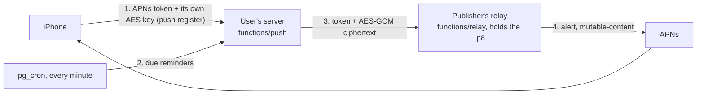

# Architecture

How Džep is put together, and why some of it looks the way it does. For what it does and how to set it up, see the [README](../README.md).

The first design mockup is `design/mockup.html`.

## Layout

| Path | What |
| --- | --- |
| `lib/idea.dart` | One row of `ideas`: an idea or a todo (`kind`) |
| `lib/session.dart` | The connected backend, GitHub sign-in and the user's `IdeaStore` / `ChatStore` (shared) |
| `lib/backend.dart`, `setup.dart` | Which Supabase project to use: parsing and checking it, setup links, the setup screen |
| `lib/onboarding/` | First-run setup: the wizard (`flow.dart`, `wizard.dart`), provisioning through the Supabase Management API (`supabase_admin.dart`, `provision.dart`), the Mac's pairing QR (`pair.dart`) and the iPhone's scanner (`scan.dart`) |
| `lib/logo.dart` | The pocket mark, drawn in Flutter (the app icons come from `tool/make_icon.swift`) |
| `lib/remind.dart` | Reminders: the `!` parser, how a time reads, which todos should have a notification pending (pure Dart, `test/remind_test.dart`) |
| `lib/store.dart` | Local JSON cache + Supabase sync (push dirty, pull since cursor, realtime) |
| `lib/controller.dart`, `popup.dart`, `main_window.dart`, `native.dart` | Mac app |
| `lib/chat.dart`, `chat_view.dart` | Quick questions: `ChatStore` (synced chats, streaming from `ask`) and the transcript/list/thread widgets (Mac and iPhone) |
| `lib/kitty.dart` | Mac: kitty's remote control through `kitten @` (windows, screen text, typing, keys, new windows) |
| `lib/terminal.dart`, `terminal_view.dart` | Terminal from iPhone: the protocol, `TerminalBridge` (Mac), `TerminalRemote` and its screens (iPhone) |
| `lib/local_api.dart` | Mac: 127.0.0.1 API for `/idea`, `/todo`, `/note` and omp's finished-session push |
| `lib/mobile.dart` | iPhone app |
| `macos/Runner/MainFlutterWindow.swift`, `AppDelegate.swift` | Popup panel + main window on one multi-view engine, menu-bar icon, Carbon hotkey, activation policy, launch at login, reminder notifications, idle time |
| `ios/Runner/AppDelegate.swift` | The iPhone half of `native.dart`: App Group, reminder notifications, push registration |
| `ios/DzepPush/` | Notification Service Extension: decrypts pushes |
| `ios/Runner/AddIdeaIntent.swift` | Siri / Action Button intents (Add Idea, Add Todo) |
| `ios/DzepWidget/` | WidgetKit extension (Todos, New idea) |
| `macos/DzepWidget/` | Mac WidgetKit extension (Todos), sandboxed; its ticks go through the running app |
| `ios/Shared/DzepShared.swift` | App Group storage + `device` function client (app and widget; the Mac's app and widget compile it too) |
| `supabase/` | Migrations and the `ask`, `device`, `pair` and `push` edge functions; `relay` is the publisher's push relay (`tool/deploy-relay.sh`) |
| `maestro/` | Simulator flows |
| `config/Dzep.xcconfig` | Team, bundle id and App Group for every Xcode target (`Local.xcconfig` overrides them) |
| `tool/setup-backend.sh`, `release.sh` | Self-hosting setup; Mac release (DMG, notarization, Sparkle appcast) |
| `integrations/omp/idea.ts` | omp extension for `/idea`, `/todo` and `/note` |
| `lib/chat_images.dart` | Images in quick questions: preparing (downscale, PNG), paste and pick, the composer strip and transcript thumbnails |

## Backend

Every user runs their own Supabase project ([SELF_HOSTING.md](SELF_HOSTING.md)), built from `supabase/migrations` and `supabase/config.toml`; nothing is shared between users. The apps learn which project on first launch, on the setup screen or from a setup link (`dzep://setup?url=…&key=…`); `lib/backend.dart` checks it against `/auth/v1/settings` (reachable, key accepted, GitHub on) and keeps it in the App Group, where the widgets and Siri intents read it too (`DzepShared.backend`). Switching projects needs signing out (`Session.disconnect`); `Supabase.initialize` then runs again for the new one, and sessions are stored per project host.

- `ideas`: ideas, todos and notes (`kind`); a todo is open or done (`done_at`) and may have a reminder (`remind_at`, null for none; clients that predate the column don't send it, so their upserts leave it alone). A note keeps its whole text in `notes` and its first line in `title` (`noteTitle`), so lists, search and apps that predate notes (which read an unknown kind as an idea) show something sensible. Ids are client-generated so capture works offline; deletes are soft (`deleted_at`) so other devices learn about them; `updated_at` is set by a trigger (the sync cursor). RLS: own rows only.
- `device_tokens`: SHA-256 of per-iPhone tokens. Siri and the widget can't reach the app's session, so they call `functions/v1/device` (`{action: add | done}`) with `x-dzep-token`; the function maps the token to the user. Deployed with `--no-verify-jwt`.
- `chats` + `chat_messages`: quick-question chats. The app picks a chat's id; only the `ask` function writes messages. A new message moves its chat's `updated_at` (trigger), so devices pull changed chats by that cursor (and realtime on `chats`) and refetch their messages. Deletes are soft (`chats.deleted_at`). RLS: own rows only, and messages only into one's own chats.
- Images in quick questions: the app downscales them (2048 px at most, PNG unless already a small PNG/JPEG/GIF/WebP), uploads each to the private `chat` bucket as `<user id>/<uuid>.<ext>` (own folder only, 10 MB, image types) and sends the paths with the question (`chat_messages.images`). `ask` reads them with the user's token and sends them as `image_url` parts; a follow-up carries the newest 8 images of the chat along.
- `functions/v1/ask` (`{chat_id, question}`, the user's token): creates the chat if new, saves the question, streams the answer from any OpenAI-compatible API (`AI_BASE_URL`, `AI_MODEL`, `AI_API_KEY`, optional `AI_EXTRA_BODY`; DeepSeek by default, with thinking off) back as server-sent events (`{delta}` … `{done}` or `{error}`) and saves it, even if the app goes away mid-answer (`EdgeRuntime.waitUntil`). Questions are capped at 16,000 characters; the history sent along is the newest 40 turns or 60,000 characters, whichever is less. Deployed with `--no-verify-jwt`: the token is checked in the function with `auth.getUser`.
- Terminal from iPhone: private Realtime broadcast on `terminal:<user id>`, nothing stored. RLS on `realtime.messages` lets only that user join, to receive or to send (a public channel of the same name is a separate room the apps never join). While its Terminal screens are open the iPhone says `hello` every 4 s; the Mac answers each with `state` (windows, projects) and, while some phone has said hello in the last 12 s, polls kitty every second and sends a watched window's `screen` (with its newest ~64 KB of scrollback; Realtime drops messages past ~100 KB) when it changes. `run` (`send`, `key`, `launch`, `close`, `image`) is answered with `ran`. The iPhone calls the Mac offline after 10 s without word. Window keys are `<socket>/<window id>`; keys are a fixed list, and nothing the phone sends reaches a shell except as typed text.
- Auth: GitHub only, through each owner's OAuth app (`[auth.external.github]`, secrets in the git-ignored `supabase/.env`); redirect `dzep://login-callback`. The `before_user_created` auth hook lets the first account in and then only emails listed in `public.allowed_signups`, so a stranger who learns the URL can't sign up and spend the owner's AI key. `delete_my_account()` deletes the caller from `auth.users`, which cascades to all their rows; the app empties their Storage folder first.
- Sync pulls page through `fetchAll` (`lib/store.dart`): PostgREST returns at most `max_rows` (1000) rows per request, and a batch upsert gives many rows the same `updated_at`, so pages are offsets in a stable order (`updated_at`, `id`) within one pull, and the cursor moves only after.
- **Setup wizard** (`lib/onboarding/`): with a Management API token the Mac app does what `tool/setup-backend.sh` does. The migrations and function sources ship as app assets (`pubspec.yaml`), so a downloaded app needs neither the repo nor the CLI. Migrations run one per transaction and are recorded in `supabase_migrations.schema_migrations`, the CLI's own table, so the script and the wizard agree on what's applied. Steps are idempotent and a retry skips the finished ones. The token is never stored.
- **Pairing** (`functions/v1/pair`, user's token): `auth.admin.generateLink({type: 'magiclink'})` for the caller's own email; it returns only the hashed token. The Mac puts it in a setup link (`dzep://setup?url=…&key=…&pair=<hash>`) shown as a QR; the iPhone redeems it with `verifyOTP(type: magiclink, tokenHash)` and gets its own session. Single use; `mailer_otp_exp` / `otp_expiry` = 600 s. A device already signed in refuses a link for another server. Deployed with `--no-verify-jwt`.

`tool/setup-backend.sh` sets all of this up on a project and is safe to run again after an update.

## Mac notes

- **Two windows, one Flutter app.** The engine runs in multi-view mode (`enableMultiView`, the private switch Flutter's own experimental multi-window API uses; it must be flipped before any view attaches, and views attach only after the engine runs). View 1 is the popup, view 2 the main window; `lib/main.dart` puts a `View` + `MaterialApp` on each and both read one `AppController`.
- The **popup** is an `NSPanel` created with `.nonactivatingPanel` (only honoured at creation): since macOS 14 a background app can't take focus from the frontmost one, and this panel takes the keyboard without activating Džep. It's a fixed transparent 720×660 and never resizes; Flutter animates the panel inside it (after any resize Flutter blocks until it has drawn the new size, and Impeller crashes on rapid ones). Esc is Dart's (`cancelOperation` is a no-op).
- The **main window** is a regular `NSWindow`. Showing it switches the app to `.regular` (Dock icon, menu bar) and activates it; closing it (⌘W, red button) hides it and switches back to `.accessory`. `LSUIElement` is gone: `AppDelegate` sets `.accessory` at launch instead. The Dock icon reopens the window.
- Flutter's engine reads "is the app visible" from NSApplication's occlusion state, which a non-activating panel doesn't update; frames would stop. Each window sends `AppLifecycleState.resumed` on `flutter/lifecycle` when it appears.
- Hiding the popup on purpose doesn't report a "blur" to Dart (a late blur would close a popup the next hotkey just opened). The popup stays mounted while hidden and reads 1/2/3/Esc through a global key handler, so a fast ⇧⌘Space-then-2 never lands before Flutter's first frame.
- Not sandboxed (global hotkey, `~/.config` file, loopback server).
- **Desktop widget** (`macos/DzepWidget/`, macOS 14+ for its tick buttons; the app still runs on 13): a WidgetKit extension in `Dzep.app/Contents/PlugIns`. Extensions must be sandboxed, so it is, with the App Group and no network. The app writes the open todos to the App Group whenever they change (`setSharedTodos`; removed on sign-out, which the widget shows as "sign in") and reloads the widget. A tick never calls the server: the widget hides the todo, queues `{action: done, id}` (the iPhone's offline queue) and posts the Darwin notification `<App Group>.queued`; the menu-bar app takes the queue (`Session.drainPending`) and ticks the todo in its store, which syncs. If Džep isn't running, that happens on its next launch.
- **App Group** (`DZEP_APP_GROUP` in `config/Dzep.xcconfig`, the iPhone's id) on both Mac targets; the app isn't sandboxed but needs the entitlement to share the container. Swift reads the id from each target's Info.plist (`DzepAppGroup`). iOS-style ids work on the Mac when a provisioning profile authorises them (macOS 15+ otherwise asks before opening the container), so both targets set `REGISTER_APP_GROUPS = YES` and automatic signing puts the group in their Mac Team profiles. `flutter run` doesn't fetch profiles: on a new Mac, or once they expire (a year), run `xcodebuild -workspace macos/Runner.xcworkspace -scheme Runner -configuration Debug -allowProvisioningUpdates build` once.
- `macos/DzepWidget/DzepWidget.xcconfig` clears `OTHER_LDFLAGS`: the project-level configs carry Runner's CocoaPods settings, which would link Flutter's plugin frameworks into the extension.
- With several `Dzep.app` builds on disk, `pluginkit -m -v -i <bundle id>.DzepWidget` shows which copy's widget macOS registered.
- **Updates**: Sparkle 2 (CocoaPod) reads `SUFeedURL`, the latest GitHub release's `appcast.xml`, and accepts only updates signed with the EdDSA key in `SUPublicEDKey`. Debug builds don't start the updater. Release builds use the Hardened Runtime, which notarization requires.

## Reminders

- Each device schedules its own local notifications (`UNUserNotificationCenter`; identifier = todo id, body = title). Which ones is Dart's call (`pendingReminders`: open todos whose reminder is still ahead, soonest first, at most 64, the iPhone's limit), redone on every store change (`Session`); the Swift side only replaces the pending set (`setReminders`). The first non-empty set asks for permission; if it was denied, enable Džep in System Settings / Settings → Notifications.
- Native code rather than `flutter_local_notifications`: the same few lines of `UNUserNotificationCenter` on both platforms, no timezone packages, and the actions need the app's own paths anyway: **Done** goes through the desktop widget's queue on the Mac (applied once the store is open, even when the click launched Džep) and through the `device` function on the iPhone (like the Todos widget, so it works with the app closed; queued if offline). A click on the Mac sends `openTodo {id}` → `AppController.openMain(select:)`; a tap on the iPhone is kept until Dart asks (`takeTappedTodo`), since the tap that launches the app arrives before Dart listens.
- **iPhone: pushed, not scheduled.** Once the iPhone has registered for push with its server, it schedules no local reminders (`Session.remindersByPush`); the server pushes each one when due, so a reminder set on the Mac arrives with the app closed, and one ticked off elsewhere never goes off. Until registration has worked once (or on a server without the `push` function) the iPhone keeps local reminders, with the old caveat: it only knows what its store saw while the app ran.

## Push notifications (iPhone)

Each user's server knows when something is due, but only the app's publisher can talk to Apple's push service for Džep (the APNs key is theirs, and it can reach every Džep install). So the servers send through one **relay** the publisher runs, and encrypt for the phone so the relay never reads anything.



- **Registration** (`MobileSession._registerPush`, on every sign-in): permission, then `registerForRemoteNotifications`; the device token and a 32-byte key the iPhone made itself (`DzepShared.pushKey`, App Group) go to `functions/push {action: register}`. Sign-out sends `unregister`.
- **Server** (`20261013090000_push.sql`): `push_devices` (token, user, key; service role only), `push_sent` (idea + `remind_at` already pushed: a moved reminder pushes again, overlapping ticks can't double-send), `push_config` (the function's own URL and a random secret, written by the first registration so no setup step has to). `pg_cron` runs every minute and calls `functions/push {action: tick}` through `pg_net` only when `push_due` has rows: open, not deleted todos due in the last 5 minutes for users with a registered iPhone, not pushed yet. `claim_due_reminders()` marks and returns them in one statement.
- **Sealing**: `{kind, title, body, id?}` as JSON, AES-256-GCM with that iPhone's key, sent as base64(nonce ‖ ciphertext ‖ tag), CryptoKit's combined form. `functions/push` posts `{token, kind, enc, collapse: todo id}` to `PUSH_RELAY_URL` (the publisher's by default); a 410 from the relay deletes the device.
- **Relay** (`functions/relay`, publisher only: `tool/deploy-relay.sh <ref> <AuthKey_ID.p8> <team>`): signs an ES256 provider token (cached 40 min), sends an alert with generic text (`Reminder` / `Terminal`), `mutable-content: 1`, the todo category for reminders and `enc`. It tries production, then the sandbox on `BadDeviceToken` (builds from Xcode / `flutter run` get sandbox tokens), and answers 410 for tokens Apple calls gone.
- **iPhone** (`ios/DzepPush`, a Notification Service Extension sharing the App Group): opens `enc` with `pushKey` and replaces the title and body, and puts `kind` and `todo` in `userInfo`. A tap on a reminder opens the todo, **Done** ticks it off like a local one; a terminal push opens the Terminal tab.
- **Terminal**: omp's extension posts `/v1/notify` on its final `agent_end`; the Mac forwards it (`push {action: notify}`, the user's token) only if nobody has touched the Mac for 60 s (`CGEventSource.secondsSinceLastEventType`).
- A fork with its own bundle id deploys its own relay and sets `PUSH_RELAY_URL` on its servers.

## Terminal API (Mac)

On launch the Mac app listens on a random 127.0.0.1 port and writes `{port, token}` to `~/.config/dzep/cli.json` (mode 600).

```
GET   /v1/ideas?project=NAME     → {"ideas": [...]}  ideas, oldest first
GET   /v1/ideas?kind=todo        → {"ideas": [...]}  open todos, oldest first
GET   /v1/ideas?kind=note        → {"ideas": [...]}  notes, oldest first
POST  /v1/ideas                  {title, kind?, notes?, project?}   (a note: its text in title, or title + notes)
PATCH /v1/ideas/ID               {done} (todos only)
POST  /v1/notify                 {title, body?} → {"sent": bool}   push to the iPhone if the Mac has been idle a minute
Authorization: Bearer <token>
```

## Building and testing

See [BUILDING.md](BUILDING.md).
