# Using Džep

Everything the apps do, in detail. For installing and setting up, see the [README](../README.md).

- [The popup (Mac)](#the-popup-mac)
- [The main window and the note window (Mac)](#the-main-window-and-the-note-window-mac)
- [Reminders](#reminders)
- [The phone apps](#the-phone-apps)
- [Ask](#ask)
- [Terminal from the phone](#terminal-from-the-phone)
- [Commands in your coding agent](#commands-in-your-coding-agent)

## The popup (Mac)

⇧⌘Space opens the popup, in the mode you used last, with its field focused. Change the shortcut in **Settings → Quick capture shortcut**. The menu-bar icon shows how many todos are open.

<table>
  <tr>
    <td>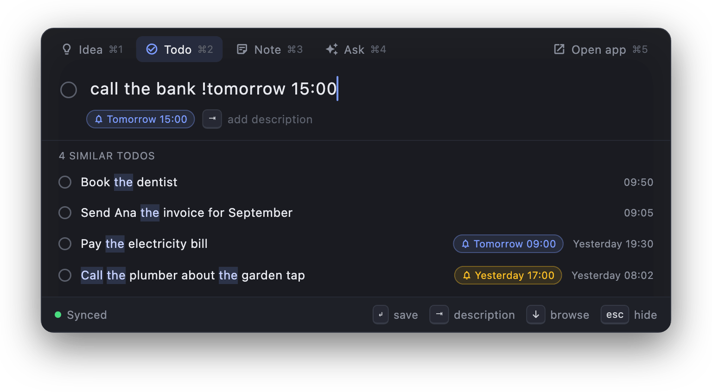</td>
    <td>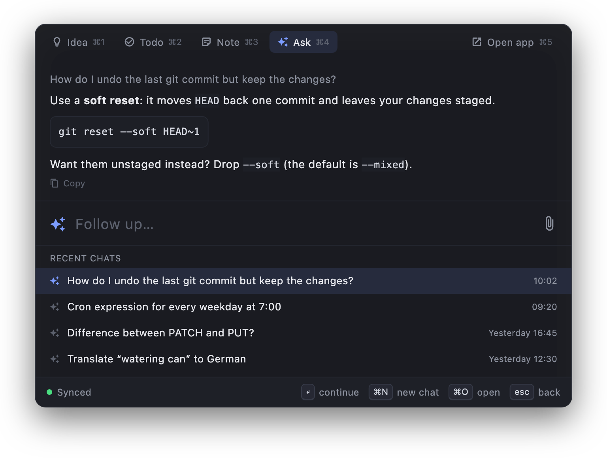</td>
  </tr>
  <tr>
    <td>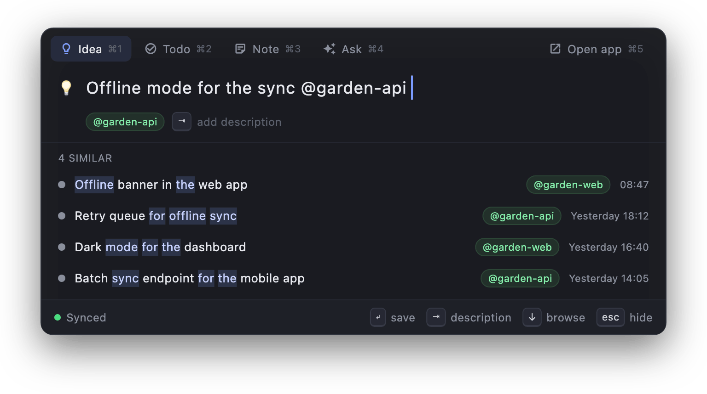</td>
    <td>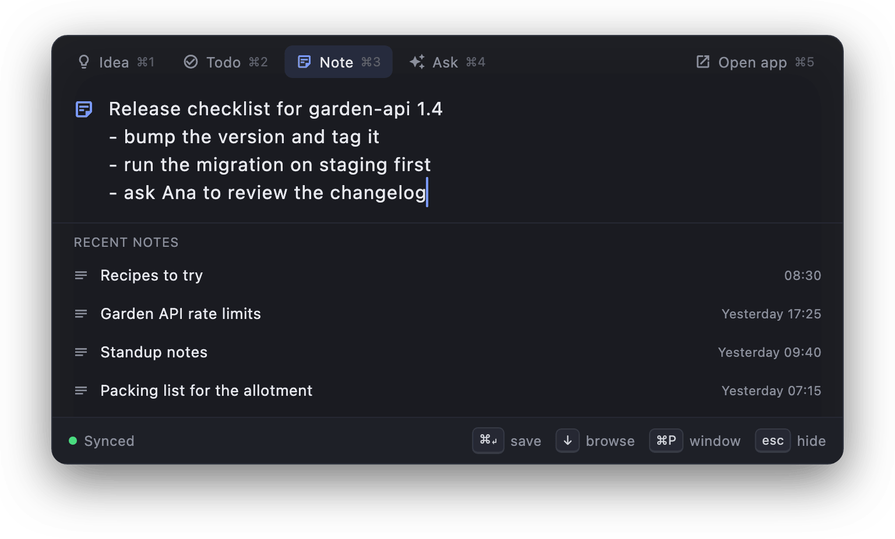</td>
  </tr>
</table>

| Key | What it does |
| --- | --- |
| ⌘1 ⌘2 ⌘3 ⌘4 | **Idea**, **Todo**, **Note**, **Ask** (or click the strip on top) |
| ⌘5 | Open the main window |
| ↵ | Save (Idea, Todo); send the question (Ask) |
| ⌘↵ | Save and stay for the next one (Idea, Todo); save the note (Note) |
| ⇥ | Add a description, or complete an `@project` (Idea, Todo) |
| ↓ ↑ | Browse the list below the field: ideas, todos, **RECENT NOTES**, or your recent chats in Ask. In Note and Ask ↓ goes to the list from the field's last line; ↑ past the top or Esc goes back to the field |
| ↵ on a selected row | Open the idea, todo or note in the main window; in Ask, continue that chat in the popup |
| ⌘D | Tick off the selected todo |
| ⌘O | Open the app on the selected item or chat (or on Notes, or on the current chat) |
| ⌘P | Float the note in its own window: the selected one, else the one being written (Note) |
| ⌘N | New chat (Ask) |
| ⇧⌘C | Copy the last answer (Ask) |
| Esc, ⌘W | Hide the popup |

`@project` in an idea's title files it under that project.

## The main window and the note window (Mac)

The main window has **Todos** (finished ones fold away at the bottom), **Ideas** (grouped by project, with descriptions), **Notes** and **Ask**. ⌘N adds, ⌘F or / searches, ↑/↓ move, ⌫ deletes (with Undo), ⌘, opens Settings.

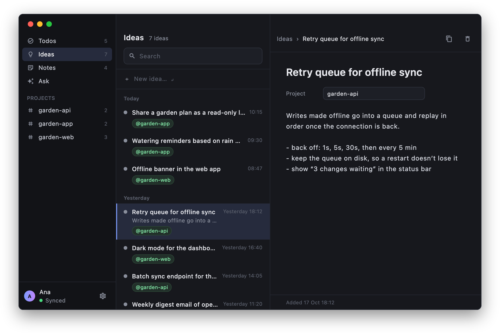

A note can float in a small window of its own over whatever you're doing: open it from the note's header in the main window, or with ⌘P in the popup.

The Mac also has a **Todos** widget (desktop or Notification Center, macOS 14 or newer) that ticks todos off.

## Reminders

End a todo with `!` and a time. A chip under the field shows what it will set. When it's due, your devices notify you, and **Done** ticks the todo off.

| Write | Reminds you |
| --- | --- |
| `!15:00`, `!9`, `!9.30`, `!3pm` | At that time today, or tomorrow if it's already past |
| `!tomorrow`, `!tmr`, `!fri` | That day at 9:00 |
| `!tomorrow 9`, `!mon 14:30` | That day at that time (a weekday is the next one ahead) |
| `!today 18:00` | Today at that time |
| `!30m`, `!2h`, `!1d`, `!1h30m` | That long from now |

For example `call bank !15:00`. Phones get reminders by push, so one set on the Mac arrives with the phone app closed, and one ticked off elsewhere never goes off.

## The phone apps

The iPhone and Android apps do the same things, each in its platform's look: iOS's on the iPhone, Material 3 on Android.

- **Tabs:** **Pocket**, **Terminal** (in the middle, where the app opens) and **Ask**.
- **Pocket** holds your todos, ideas and notes in one list: open todos first, then ideas and notes, newest first, and ticked-off todos folded under **Done**. **Todos**, **Ideas** and **Notes** at the top narrow it to one kind, and with Ideas, the project pills to one project. One search finds all three. **+** adds what the list shows (a todo in **All**; the sheet switches to an idea or a note). Swipe a row right to tick a todo off, left to delete.
- **Widgets:** **Todos** (tick todos off from the Home Screen) and **New idea** (opens the add field).
- **Account:** the avatar at the top opens Sign out and Delete account.

<table>
  <tr>
    <td>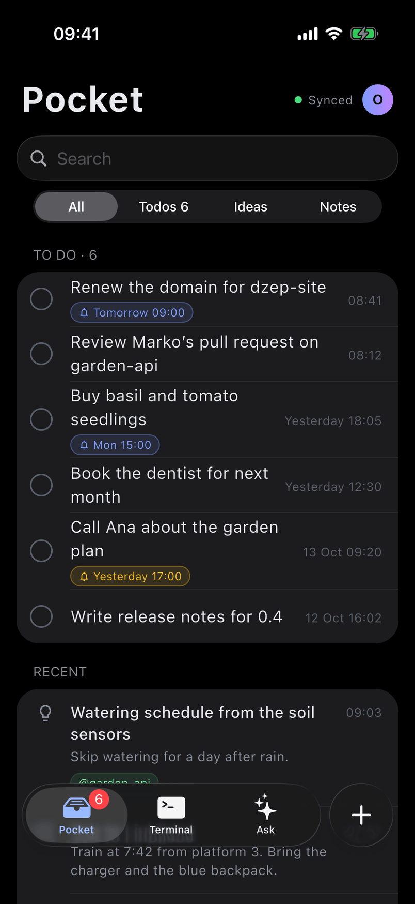</td>
    <td>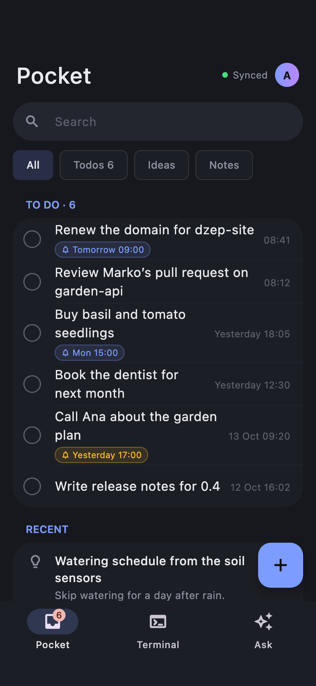</td>
    <td>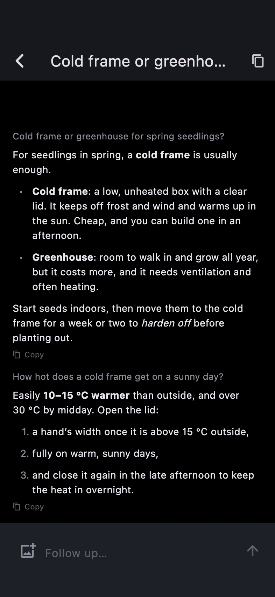</td>
  </tr>
</table>

### Adding a phone

A phone signs in only with a code from your Mac, never with a password or GitHub. On the Mac, open **Settings → Set up phone…**: it shows a QR code. In the phone app, tap **Scan the code from your Mac** (or **Paste a code instead**). The phone connects to your server and signs in as you.

A code works **once**, for **10 minutes**, and anyone who scans it gets into your account, so show it only to your own phone. For App Store or Play review, **Settings → Reviewer access** makes a code for a separate demo account ([details](SELF_HOSTING.md#app-store-and-play-review)).

**Does the Mac have to be on?** Not for your data: ideas, todos, notes, reminders and Ask live on your server, so the phones work on their own with the Mac off. The Mac is needed only to add a phone (its code) and for [Terminal from the phone](#terminal-from-the-phone).

## Ask

A small streamed chat with the AI you connected: any OpenAI-compatible provider (OpenAI, OpenRouter, Groq, DeepSeek, a local Ollama, …). Paste or attach up to 4 images per question. Chats sync: start on one device, continue on another.

No AI yet? Connect one from the Mac: **Settings → AI → Connect…** (or **Connect an AI…** in Ask); once one is connected, the same button reads **Change…**. The key stays on your server; the apps never see it. To switch providers from a terminal, see [AI provider](SELF_HOSTING.md#ai-provider).

## Terminal from the phone

The phone's Terminal tab, where the app opens, lists the Mac's coding sessions (omp and Claude Code) under a heading for each project (its folder's name and how many run there), the project with a session needing you first, and below them the Mac's other terminal windows.

<table>
  <tr>
    <td>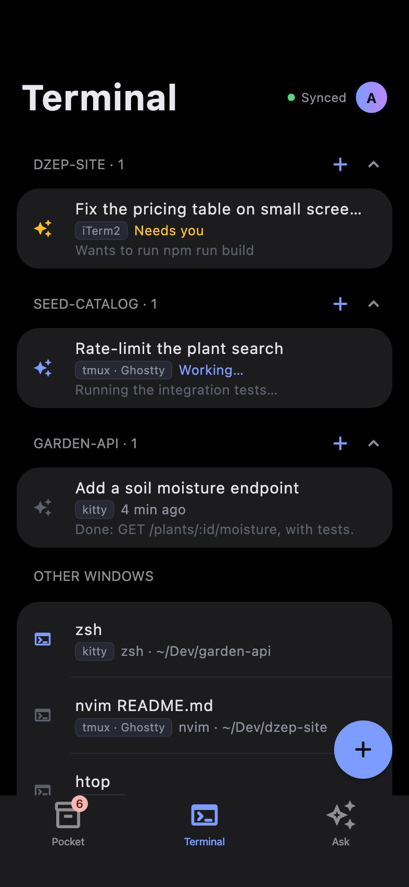</td>
    <td>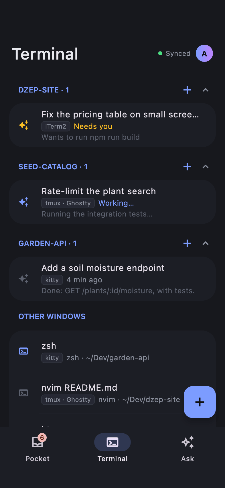</td>
    <td>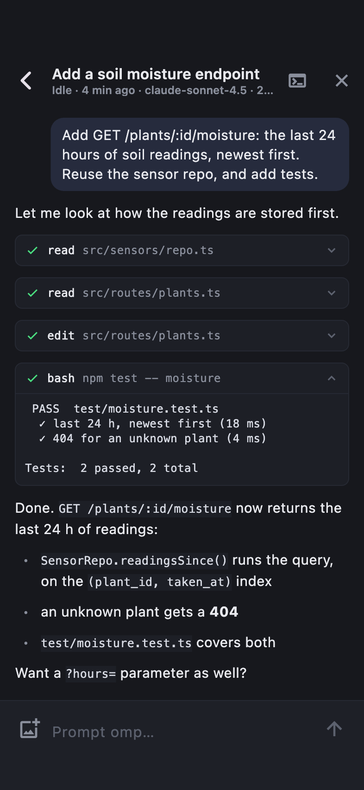</td>
  </tr>
</table>

- **A coding session** opens as a conversation laid out for the phone: your prompts, the agent's answers, tool calls as cards. Prompt it (with images), stop it, answer its questions, tool approvals and plan reviews. While omp works you can steer it or queue a prompt; Claude Code can't be steered, so a prompt waits for its run to end. Typing `/` suggests the agent's slash commands.
- **Any window**, a shell included, also opens as its live screen you can type into.
- **A project heading's +** starts your coding agent in a new window in that folder and opens it. Tap a heading to fold the project to just its heading; it stays folded next time, and shows a yellow dot when a session in it needs you.
- **Swipe a row left** to close its window on the Mac: the row asks **Keep** / **Close** in its place, and goes back by itself after a few seconds. The close button on a session or screen asks the same above the composer.
- **+** at the bottom opens a new window in one of the Mac's projects (the git repositories in your **Project folders**, or any `~/path` you type), with a shell or your coding agent. **New project…** there makes a new folder in one of your Project folders and opens a window in it. It opens without taking the focus from what you're doing on the Mac.
- When a run ends or the agent needs you while you're away from the Mac, a push takes you to that session. A session you follow shows as a **Live Activity** on the iPhone (Lock Screen, Dynamic Island) and as an **ongoing notification** on Android.

What works in a window depends on its terminal: see the [table in the README](../README.md#terminal-from-the-phone). The phone shows only what works. With tmux installed (`brew install tmux`), sessions the phone starts in Terminal or Ghostty run inside tmux and get full control.

The Mac has to be awake, with Džep running and **Terminal from phone** on: the sessions and windows are on the Mac, and the phone only shows and drives them. While it's on, Džep keeps the Mac from idle sleep, but a closed lid (without an external display) or a shut-down Mac ends it, and the phone says the Mac isn't answering.

### Turning it on

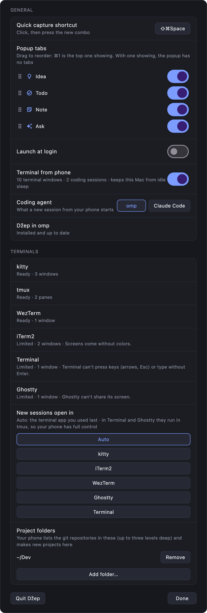

1. On the Mac, turn on **Settings → Terminal from phone**. It's off by default.
2. **Settings → Terminals** lists the terminals Džep found, each **Ready**, **Limited** (and why) or **Needs setup**.
   - **kitty:** click **Set up**, then restart kitty. It backs up `kitty.conf` (`.dzep-backup`) and appends `allow_remote_control socket-only` and `listen_on unix:/tmp/kitty`. Only kitty windows of your own macOS account show up.
   - **iTerm2, Terminal and Ghostty:** macOS asks once whether Džep may control them. If you said no, click **Allow…** there, or turn Džep on in System Settings → Privacy & Security → Automation.
   - **tmux and WezTerm** need nothing.
3. **New sessions open in** picks the terminal a session from your phone opens in: **Auto** (the running terminal you used last, else the first that works) or a specific one.
4. **Project folders** lists the folders that hold your projects: **Add folder…** picks one or more, **Remove** drops one. Your phone lists the git repositories in them (up to three levels deep) and makes new projects there. There are none until you add one; the phone can still open any path you type.
5. In **Settings → Coding agent**, pick omp or Claude Code: it's what a new session from your phone starts. The row under it, **Džep in …**, installs or updates Džep's integration for that agent. Restart running sessions afterwards.

Claude Code needs version 2.1.287 or later. If Settings says its mods are off, run `claude /login`, start `claude` once, then restart your sessions.

To install the integration by hand instead:

- **omp:** copy [idea.ts](../apps/dzep-macos-app/integrations/omp/idea.ts) and [live.ts](../apps/dzep-macos-app/integrations/omp/live.ts) to `~/.omp/agent/extensions/`.
- **Claude Code** (with mods on): from a checkout of this repo, `claude plugin marketplace add apps/dzep-macos-app/integrations/claude`, then `claude plugin install dzep@dzep`.

Problems with a terminal? See the [troubleshooting table](SELF_HOSTING.md#troubleshooting). How it works inside: [ARCHITECTURE.md](ARCHITECTURE.md#terminals-mac).

## Commands in your coding agent

The integration also adds three commands to omp and Claude Code, saved through the Mac app (no agent turn, and they work while the agent works) and filed under the current repo's name:

| Command | Saves |
| --- | --- |
| `/idea <text>` | An idea (`/idea list` lists this project's) |
| `/do <text>` | A todo, reminders included: `/do call bank !15:00` (`/do list`, `/do done 2`) |
| `/note <text>` | A note |

Other tools can use the same [local API](ARCHITECTURE.md#terminal-api-mac).
